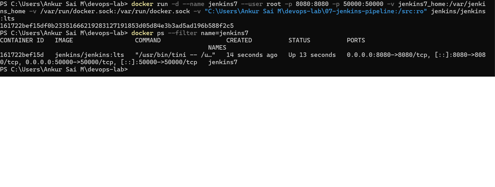
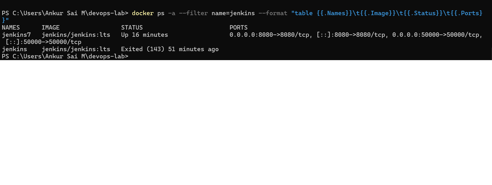
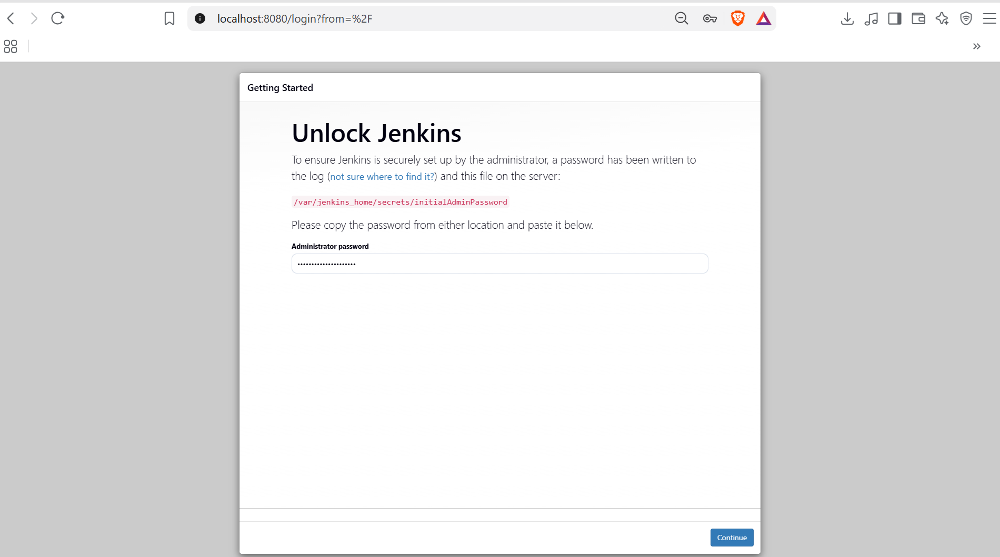
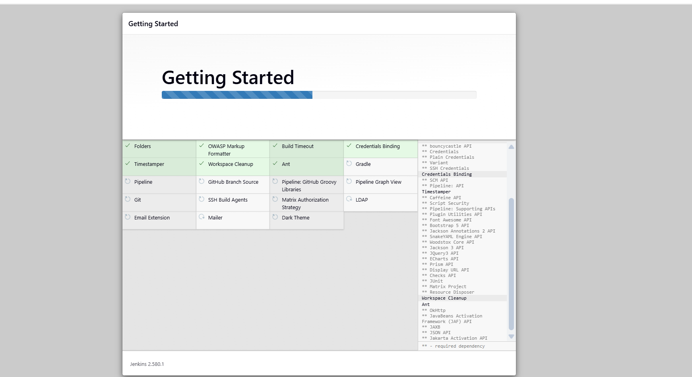
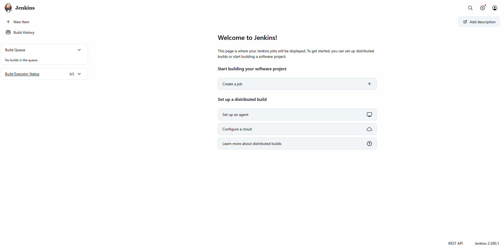
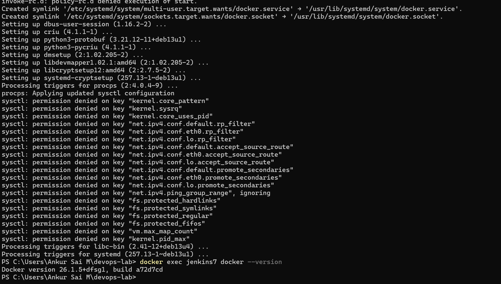

# Exercise 7: Introduction to CI and Jenkins Installation

## Objective
Understand Continuous Integration, then install Jenkins with Docker, unlock it with the initial admin password, and complete the first-time setup.

## Environment
Windows 11, Docker Desktop 29.7.2, jenkins/jenkins:lts (Jenkins 2.580.1).

## Command used
The exercise runs:

    docker run -d --name jenkins -p 8080:8080 -p 50000:50000 jenkins/jenkins:lts

I ran a variation:

    docker run -d --name jenkins7 --user root -p 8080:8080 -p 50000:50000 -v jenkins7_home:/var/jenkins_home -v /var/run/docker.sock:/var/run/docker.sock -v "C:\Users\Ankur Sai M\devops-lab\07-jenkins-installation:/src:ro" jenkins/jenkins:lts

Why it differs:
- **jenkins7 and its own volume:** I already had a configured Jenkins from Exercise 6. I stopped it and started a fresh one, so the first-time unlock and plugin screens appear again.
- **Named volume:** keeps Jenkins data if the container is recreated.
- **Docker socket, root user and /src mount:** these let Jenkins run Docker commands and read project files, which I needed for Exercise 6. They are not needed for this exercise.
- **Port 8080** is the web interface and **50000** is for agents, as in the exercise.

## Steps and evidence
1. Start Jenkins and check it is running. The Exercise 6 container is Exited (I stopped it to free port 8080) and the new one is Up.

2. Get the initial admin password with `docker exec jenkins7 cat /var/jenkins_home/secrets/initialAdminPassword`. The password is not shown here or stored in this repo.
3. Open http://localhost:8080 and paste the password on the Unlock Jenkins page.

4. Install suggested plugins. This screenshot was taken part way through.

5. Create the admin user, keep the default URL, and start using Jenkins.

Extra: I also installed the Docker CLI inside this Jenkins with apt-get (docker.io), as I did for Exercise 6. The sysctl permission denied messages during that install are normal inside a container.

## What I learned
- Continuous Integration means merging code often and letting an automated build and test run catch problems early.
- Jenkins is an automation server. Its web interface is on port 8080 and agent connections use 50000.
- First start needs an initial admin password, stored in a file inside the container, which I read with docker exec.
- A new Docker volume gives a clean Jenkins with the setup screens again.