# Exercise 8: Creating a "Hello World" Jenkins Job

## Objective
Put a shell script on GitHub, then create a Jenkins Freestyle job that pulls it from the repository and runs it.

## Environment
Windows 11, Docker Desktop, Jenkins 2.580.1 (jenkins/jenkins:lts in Docker, container jenkins7).

## Second repository
The script lives in its own public repository, as the exercise asks: https://github.com/ankursaiis23-ctrl/devops-sample-code

This folder holds a copy of hello-world.sh, the build log and all screenshots.

## Changes I made to the exercise, and why
- **touch and chmod +x** do not exist in PowerShell. I wrote the file with PowerShell using Linux line endings (LF), because Windows line endings would add a stray \r to every line in the script. The file is 35 bytes. The job runs it with `sh hello-world.sh`, so no executable flag is needed.
- **Branch name:** the exercise commits on master but pushes to main. I created the branch as main with `git init -b main`. Jenkins defaults to `*/master`, so I changed the Branch Specifier to `*/main`, otherwise the build would fail.
- **Git name and email** were already set from earlier exercises, so I skipped that step.
- **Token:** I created a fine-grained token limited to this one repository (Contents: Read and write). The push did not ask for it, because Git Credential Manager already had my GitHub login. The token is not stored anywhere in this repo.
- **Credentials in Jenkins:** none, because the repository is public.

## Part 1: GitHub repository and script
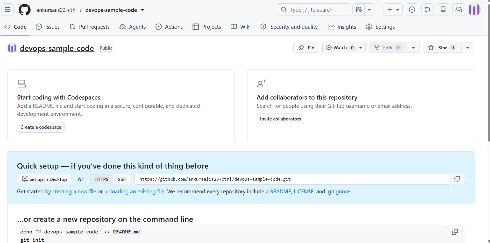
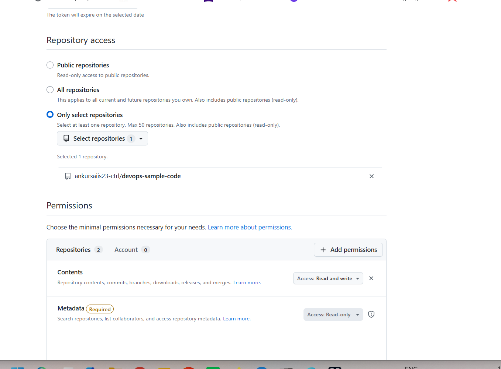
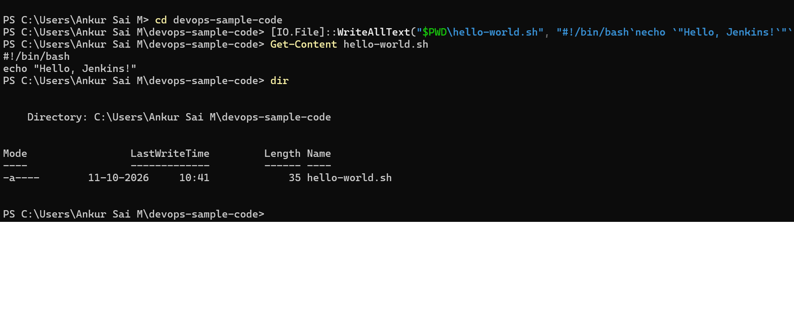
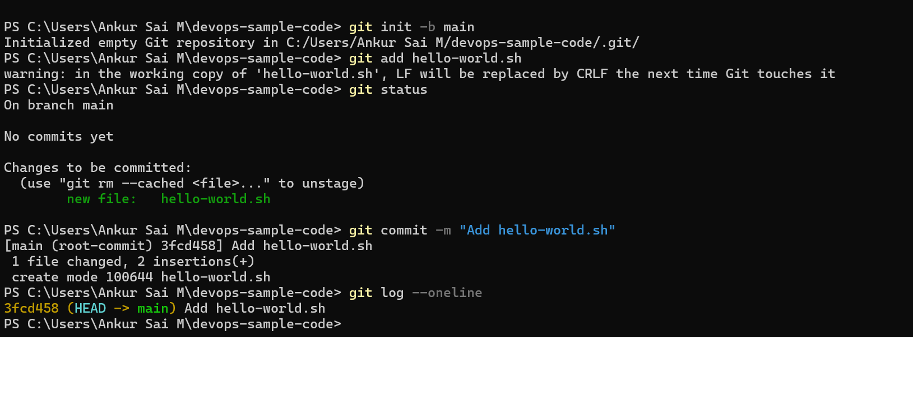
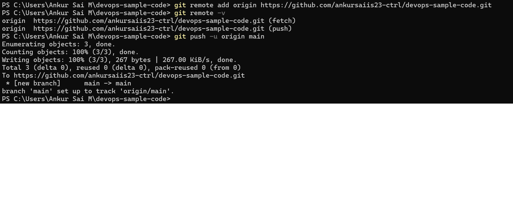
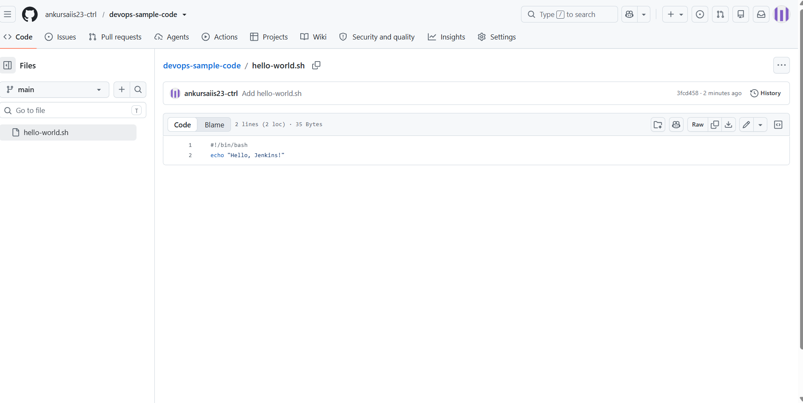
## Part 2: Jenkins Freestyle job
Job name HelloWorld, description "Hello World! Jenkins job.", Git repository above, branch `*/main`, build step Execute shell with `sh hello-world.sh`.

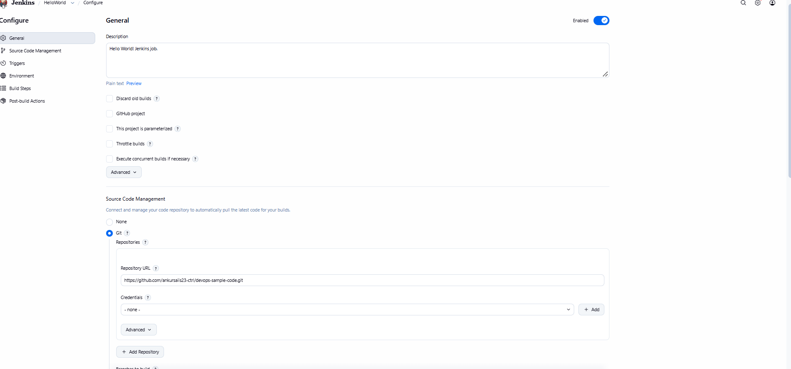
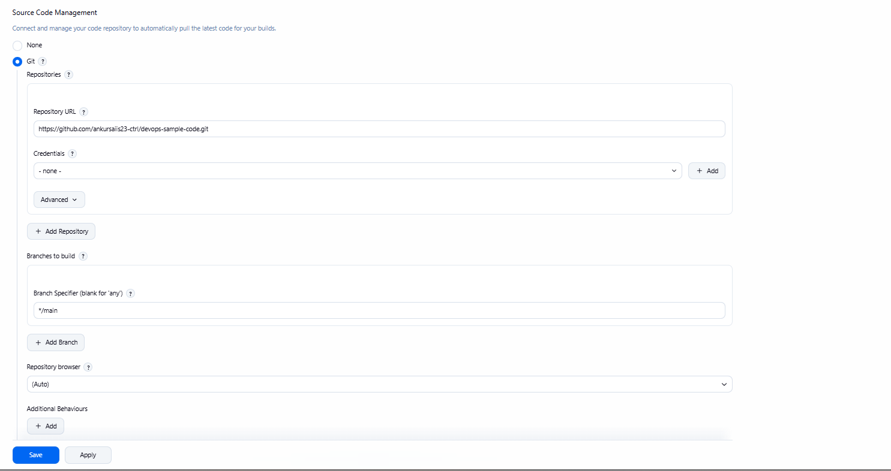
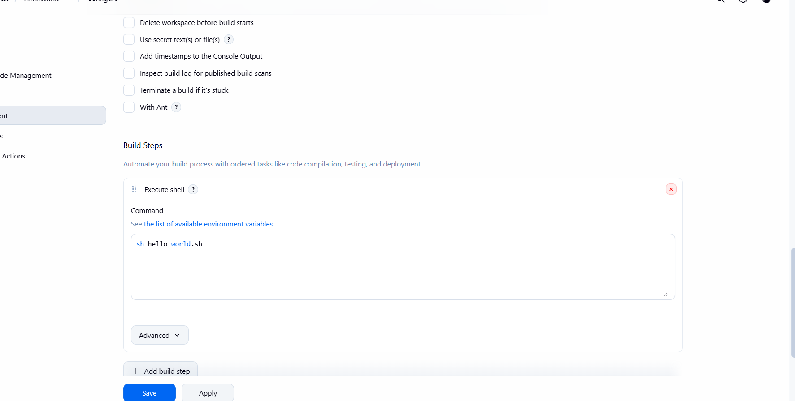
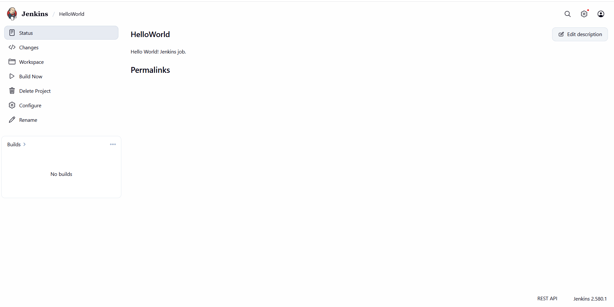

## Part 3: Build output
Build #1 cloned the repository, checked out commit 3fcd458 (Add hello-world.sh) on main, ran the script and finished with SUCCESS. The full log is in console-output.txt. Jenkins shows my username as Admin2.

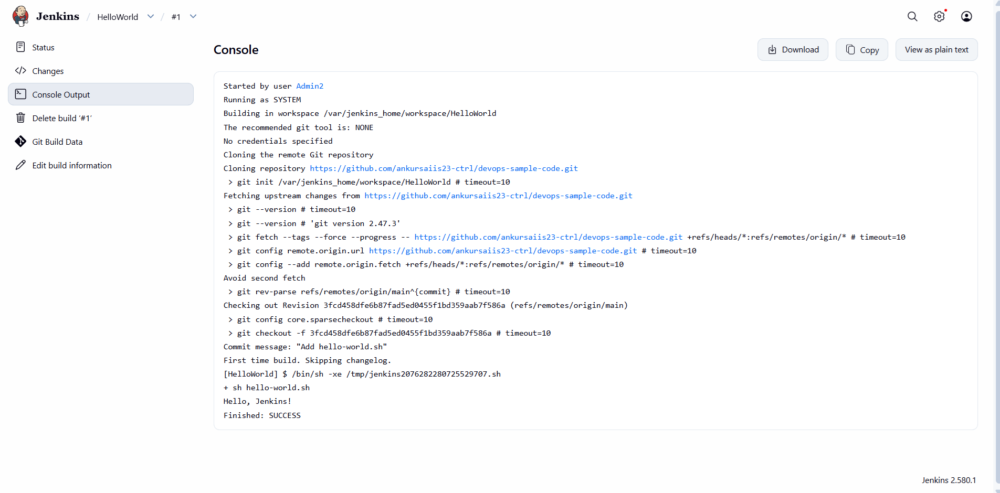

## What I learned
- Jenkins can pull code from a Git repository and run it as a build step, so a build starts from what is in the repository.
- The branch in the job must match the repository's real branch name, or the build fails.
- Line endings matter for shell scripts: a script written on Windows can break on Linux if it has CRLF endings.
- A public repository needs no credentials in Jenkins, and a fine-grained token should only get the access it needs.