# Exercise 10: Multi-Node Kubernetes Cluster with Multiple Apps and ReplicaSets

## Objective

Run two small Flask services (Product Catalog and Shopping Cart) on a 3-node Minikube cluster, with 2 and 3 replicas, and make sure the replicas of each service run on different nodes (pod anti-affinity). If one node fails, both services stay available.

## Files in this folder

| File | Purpose |
|---|---|
| `product_catalog.py` | Flask app, `GET /products` |
| `shopping_cart.py` | Flask app, `GET` and `POST /cart` (cart kept in memory) |
| `Dockerfile.product`, `Dockerfile.shopping` | Images for the two apps (python:3.9-slim + Flask) |
| `product_catalog_deployment.yaml` | Deployment, 2 replicas, podAntiAffinity on hostname |
| `shopping_cart_deployment.yaml` | Deployment, 3 replicas, podAntiAffinity on hostname |
| `product_catalog_service.yaml`, `shopping_cart_service.yaml` | NodePort services on port 80 |
| `item.json` | Test item for the POST request |

## Environment

Windows 11, PowerShell, Docker Desktop (WSL2), Minikube v1.39.0 with the docker driver, Kubernetes v1.37.0.

The Chocolatey `kubectl.exe` is blocked on this laptop by a Windows Application Control policy (see Troubleshooting). I used the kubectl that Minikube provides, through a small alias. In this README `kc` means kubectl:

```powershell
function kc { minikube -p devops-multinode kubectl -- @args }
```

## Steps

1. Cleaned up any old cluster: `minikube stop` and `minikube delete`.
2. Started a 3-node cluster: `minikube start --nodes 3 -p devops-multinode --memory 2048 --cpus 2` (2 GB and 2 CPUs per node)
   - Also enabled the registry add-on (Step 1b of the exercise): `minikube -p devops-multinode addons enable registry`. I ran it at the end, after everything already worked, because `minikube image load` puts the images straight into the nodes. The `registry` pod and one `registry-proxy` pod per node are Running in `kube-system`.
3. Built the two images:
```powershell
   docker build -t product-catalog:latest -f Dockerfile.product .
   docker build -t shopping-cart:latest -f Dockerfile.shopping .
```
4. Loaded the images into the cluster and checked every node:
```powershell
   minikube -p devops-multinode image load product-catalog:latest
   minikube -p devops-multinode image load shopping-cart:latest
   minikube -p devops-multinode ssh -n devops-multinode-m02 -- "sudo crictl images | grep -E 'product|shopping'"
```
5. Applied the deployments and services:
```powershell
   kc apply -f product_catalog_deployment.yaml
   kc apply -f shopping_cart_deployment.yaml
   kc apply -f product_catalog_service.yaml
   kc apply -f shopping_cart_service.yaml
```
6. Checked where the pods run: `kc get pods -o wide`
7. Opened each service in its own PowerShell window (the docker driver on Windows needs the terminal to stay open):
```powershell
   minikube -p devops-multinode service product-catalog-service --url
   minikube -p devops-multinode service shopping-cart-service --url
```
8. Tested with `curl.exe` against the printed URLs.

## Results

All 5 pods are `1/1 Running` and spread over the nodes:

| Pod | Node |
|---|---|
| product-catalog-7cb85d4f-r2br5 | devops-multinode-m03 |
| product-catalog-7cb85d4f-rxm79 | devops-multinode-m02 |
| shopping-cart-6858b5f797-8g6pb | devops-multinode-m03 |
| shopping-cart-6858b5f797-ptslb | devops-multinode-m02 |
| shopping-cart-6858b5f797-zhbkg | devops-multinode (control-plane) |

Deployments: `product-catalog` 2/2 and `shopping-cart` 3/3. Both services are NodePort on port 80.

Tests (`curl.exe`):

- `GET /products` returned Laptop 1200, Phone 800 and Headphones 150.
- `GET /cart` returned `[]` at first.
- `POST /cart` with `item.json` returned `[{"id":1,"name":"Laptop","quantity":1}]`.
- Repeated `GET /cart` returned the item only on some requests, because each of the 3 pods keeps its own in-memory cart and the service spreads requests across them. This shows the load balancing and also why real apps need shared storage.
## Troubleshooting

### 1. `kubectl.exe` blocked by Windows Application Control

- **Symptom:** `kubectl get nodes` failed with "An Application Control policy has blocked this file" for `C:\ProgramData\chocolatey\bin\kubectl.exe`. `minikube start` printed the same message at the end, although the cluster itself was healthy.
- **Diagnosis:** The Minikube cluster was running (`minikube status` showed all 3 nodes Running), so only the kubectl program was blocked by a policy on this laptop.
- **Fix:** I did not change any security setting. I used the kubectl that Minikube downloads itself, through the alias `kc` (`minikube -p devops-multinode kubectl -- ...`).

### 2. Docker Desktop crashed and the engine would not start

- **Symptom:** While loading images, Docker Desktop turned itself off. After that it stayed on "Starting the Docker Engine..." and `docker version` / `docker ps` returned `500 Internal Server Error`.
- **Diagnosis:**
  - Task Manager showed leftover Docker processes, which I ended, and `wsl --shutdown` followed by a restart was not enough.
  - `wsl --status` and `wsl -l -v` were normal, so WSL itself was fine.
  - Docker's own log (`%LOCALAPPDATA%\Docker\log\vm\init.log`) was full of `blob ... input/output error` lines for every image.
  - `Get-CimInstance Win32_LogicalDisk` showed **0 GB free on C:**. The Downloads folder alone held about 23 GB, including two identical 6.2 GB Ubuntu ISO files.
- **Cause:** The C: drive was full. Docker's virtual disk (`docker_data.vhdx`, about 35 GB) could not write, which caused the I/O errors and the engine failure. Docker was also limited to about 7.6 GB of RAM, which was tight for 3 Minikube nodes plus other containers.
- **Fix:**
  - Deleted the duplicate ISO files (12.4 GB free afterwards).
  - Gave Docker more memory with a `.wslconfig` file (`memory=10GB`, `swap=4GB`; the laptop has 16 GB).
  - Ran `wsl --shutdown` and restarted Docker Desktop. The engine came back with all images and containers intact.
  - Ran `minikube start -p devops-multinode`, which restarted the 3 existing nodes.

### 3. Image missing on some nodes

- **Symptom:** `minikube image load shopping-cart:latest` said the image "was not found", and `image ls` was empty. Later, `crictl images` showed that node `m03` had no `product-catalog` image.
- **Cause:** The first loads ran while Docker was failing. The deployments use `imagePullPolicy: Never`, so every node needs its own copy of each image.
- **Fix:** Reloaded the images with `minikube image load` and checked each node with `minikube -p devops-multinode ssh -n <node> -- "sudo crictl images | grep -E 'product|shopping'"` until all 3 nodes listed both images.

### 4. Pods in `Error`: `exec format error`

- **Symptom:** After the first apply, 3 of 5 pods were in `Error`, on `devops-multinode` and `m02`. The pods on `m03` were fine. `kc logs <pod>` showed `exec /usr/local/bin/python: exec format error`.
- **Diagnosis:** An "exec format error" means the node cannot run the program. I first checked the CPU architecture (`crictl inspecti`) and it was `amd64` on all nodes, so it was not an architecture mismatch. That left damaged image files on those nodes. Most likely they were written while the disk was full, but I did not find out which file was damaged.
- **Fix:** Deleted the deployments, removed the images from the nodes with `crictl rmi`, reloaded them and re-applied the deployments. `m02` worked after the first clean. The control-plane node needed a second clean. This time I made sure no old containers were left, removed both images, waited a minute and reloaded. Afterwards all 5 pods were `Running`.

### 5. Cart sometimes returns `[]`

This is not an error. Each pod keeps its own in-memory cart, and the service sends requests to any of the 3 pods (see Results).

## Differences from the exercise text

- The shopping cart deployment in the exercise uses the namespace `devops-exercise`, which does not exist in my cluster. I changed it to `default`, the same namespace as the services.
- `--force` on `minikube start` is not needed on Windows because I am not running as root.
- Images were loaded with `minikube image load` and checked per node with `crictl`, because the nodes use containerd and `docker images` does not exist inside them.
- On Windows I used `--url` for the services (each in its own window) and `curl.exe`. The POST body comes from `item.json`, because PowerShell mangles quotes in inline JSON.

## What I learned

- `podAntiAffinity` with `requiredDuringSchedulingIgnoredDuringExecution` and `topologyKey: kubernetes.io/hostname` puts at most one pod of an app on each node. With 3 nodes, 3 replicas fit exactly, and a 4th would stay Pending.
- With `imagePullPolicy: Never`, the image has to exist on every node, not just one. Check every node.
- A Deployment creates a ReplicaSet that keeps the wanted number of pods running, and the Service spreads traffic across them.
- Keeping state in memory does not work with several replicas, because each pod has its own copy. Real apps need a shared database or cache.
- Debug order for a failing pod: `get pods`, then `logs`, then `describe`. Read the actual error text before changing anything.
- A full disk can show up as unrelated failures: Docker not starting, I/O errors and broken images. Checking free space early would have saved time.

## Screenshots

### Prechecks before starting

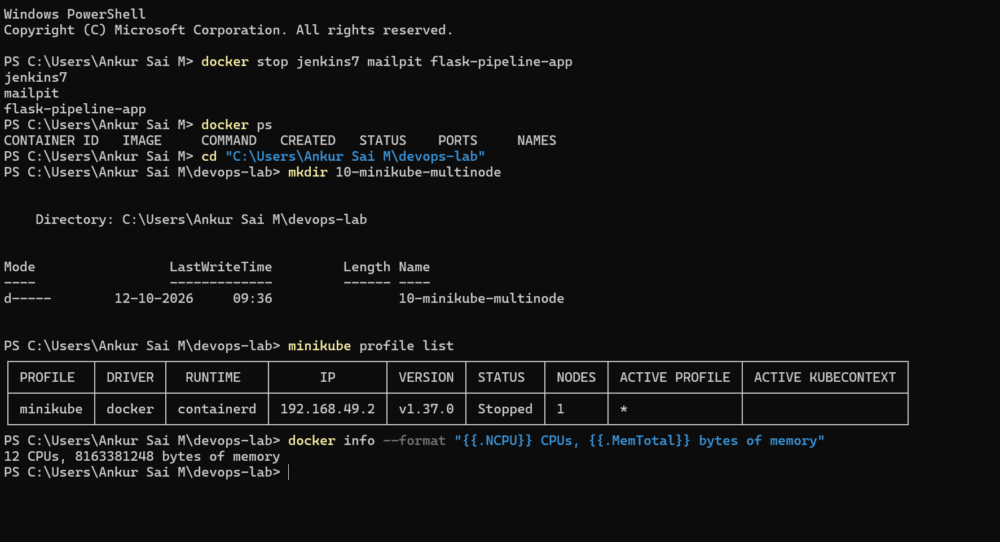

### Cleaning up the old cluster

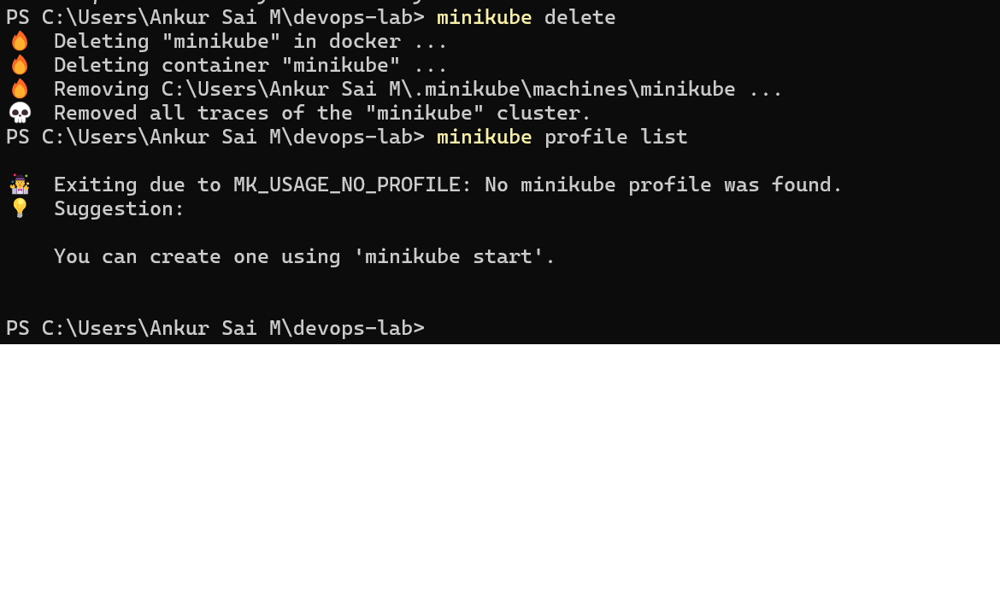

### Python files and Dockerfiles created

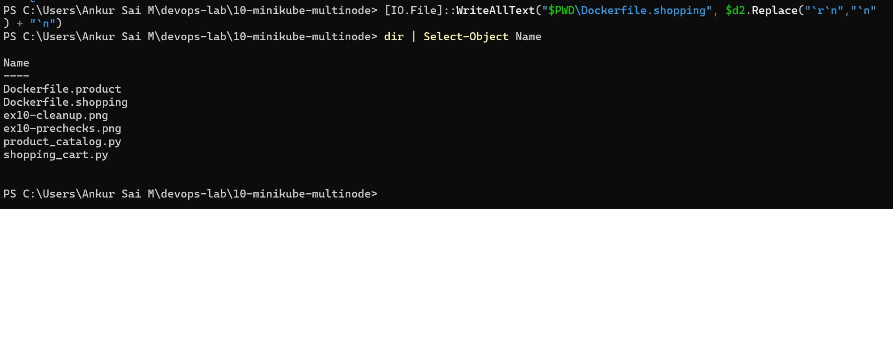

### Docker images built

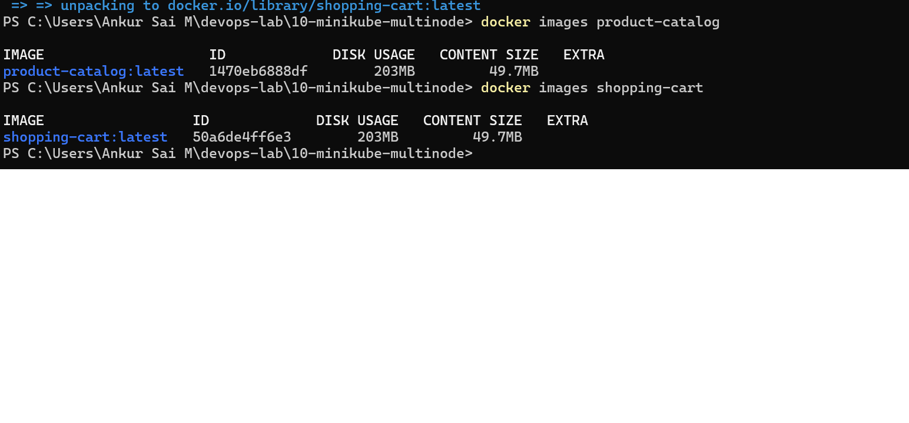

### Starting the 3-node cluster

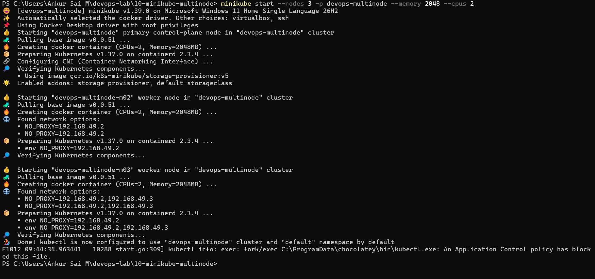

### 3 nodes Ready

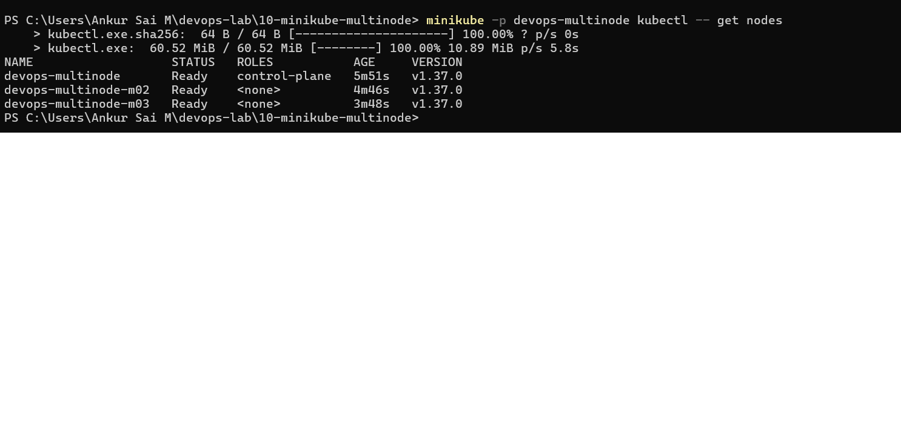

### Problem: C: drive at 0 GB free

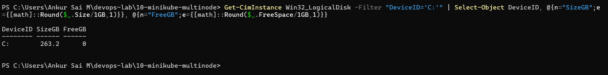

### Fix: memory setting (.wslconfig) and free disk space after cleanup

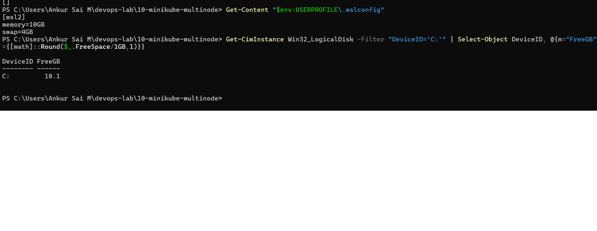

### Problem: node m03 missing the product-catalog image

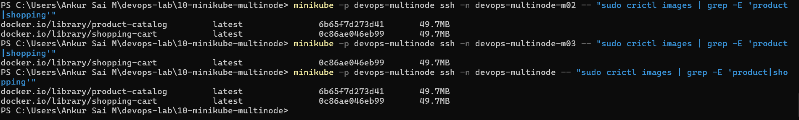

### Both images present on all 3 nodes

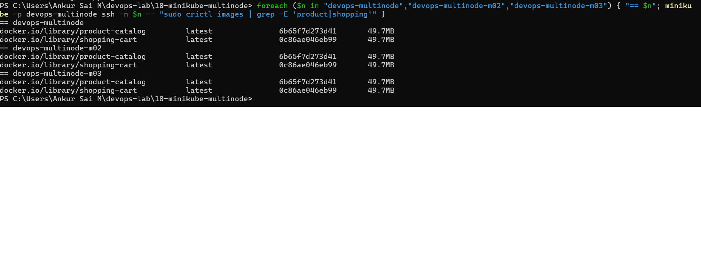

### Deployment and service manifests created

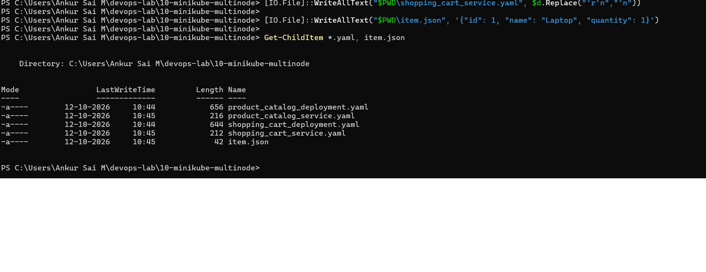

### Applying the manifests

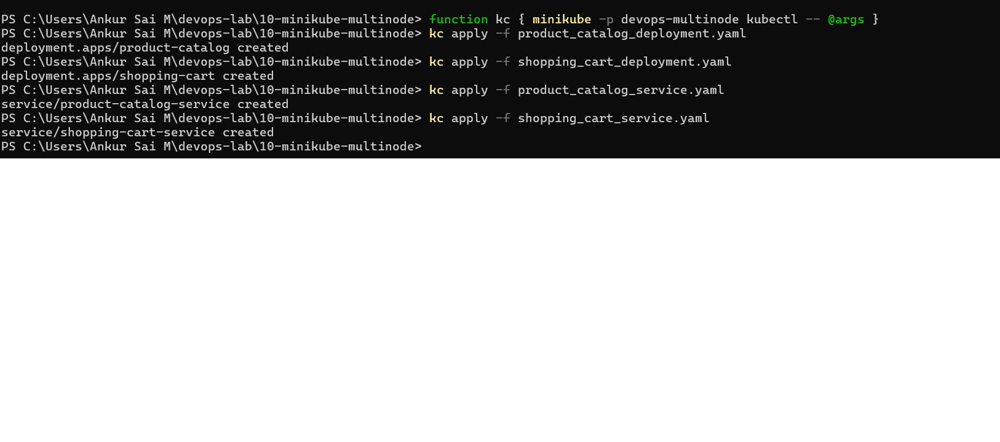

### Problem: pods in Error (exec format error)

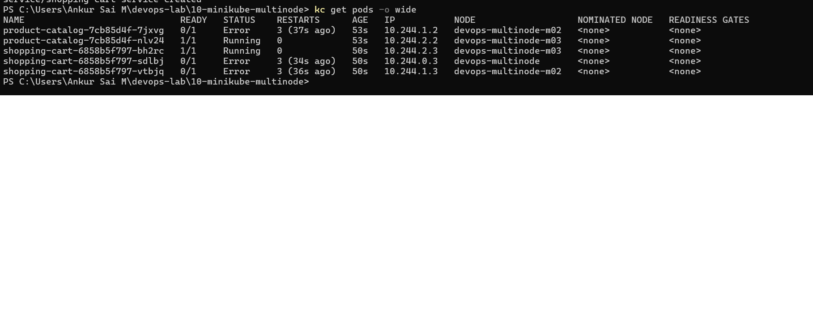

### Result: 5 pods Running on different nodes

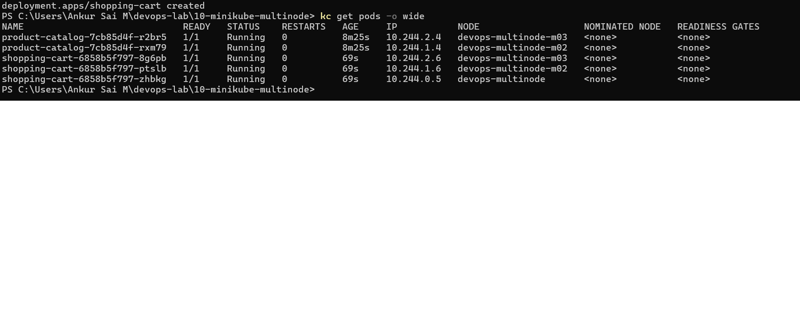

### Deployments and NodePort services

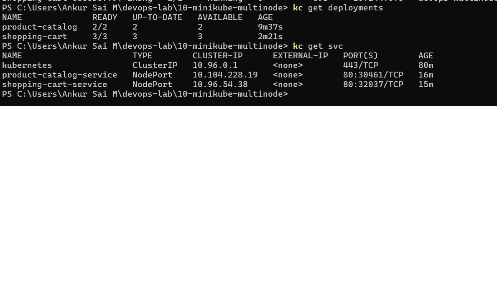

### Tunnels to the two services

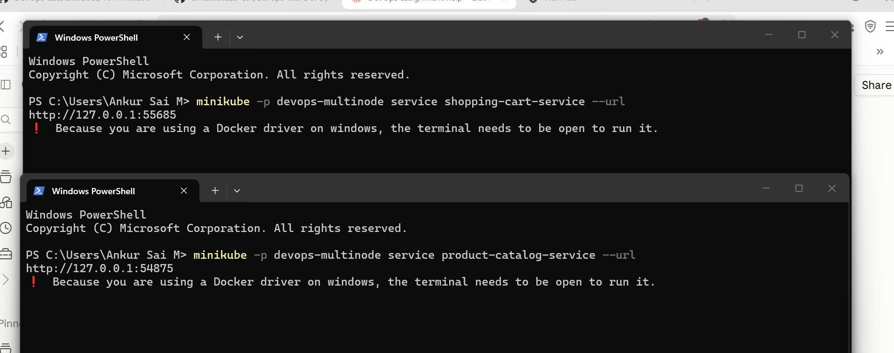

### Testing with curl

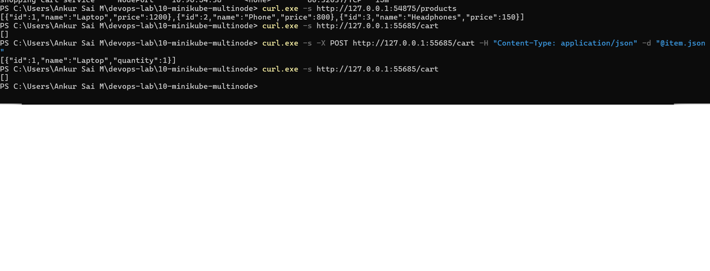

### Requests spread across the 3 cart pods

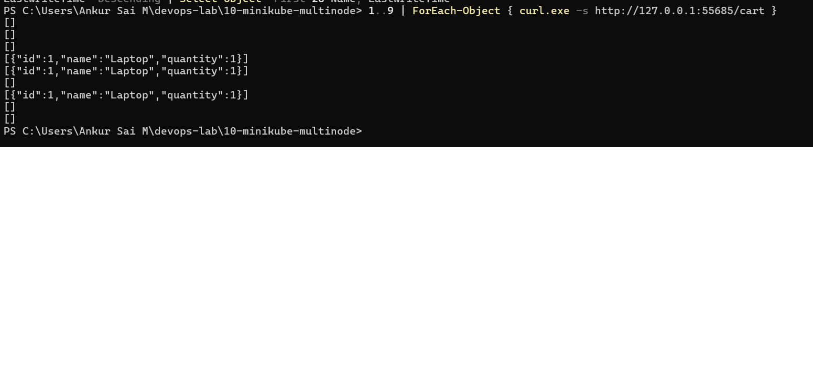

### Product Catalog in the browser

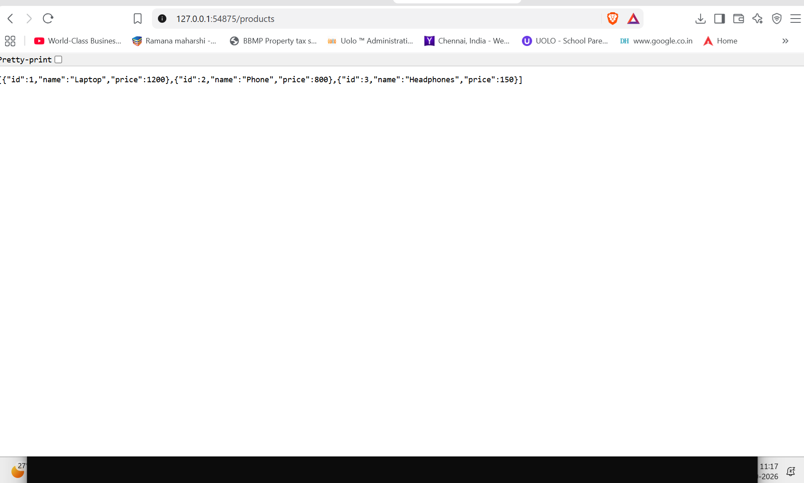

### Shopping Cart in the browser

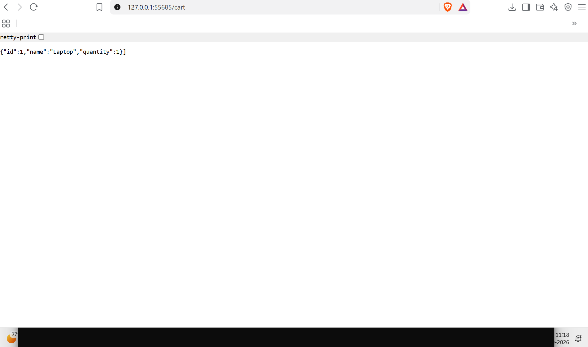

### Registry add-on enabled

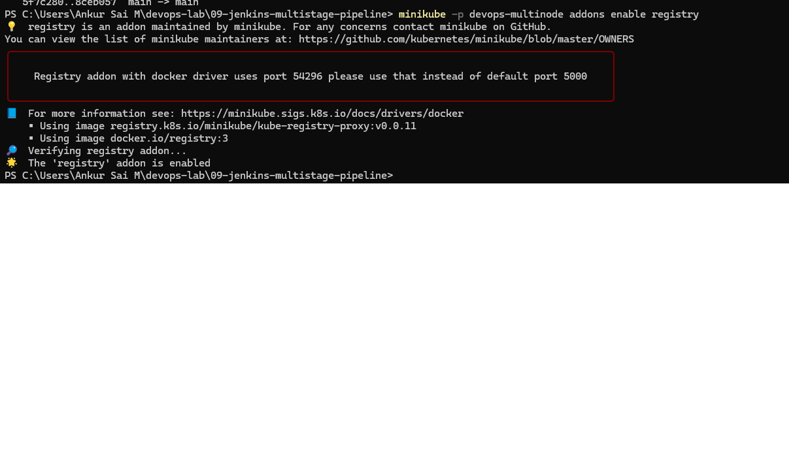

### Registry pods Running and the app pods unaffected

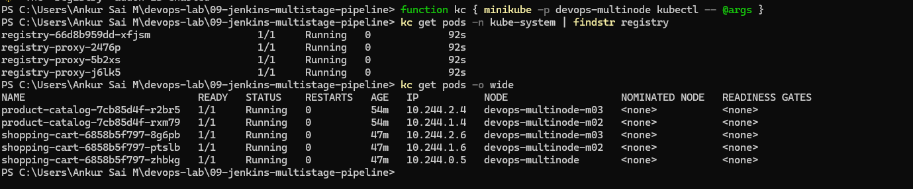

## Cleanup

```powershell
minikube stop -p devops-multinode
```